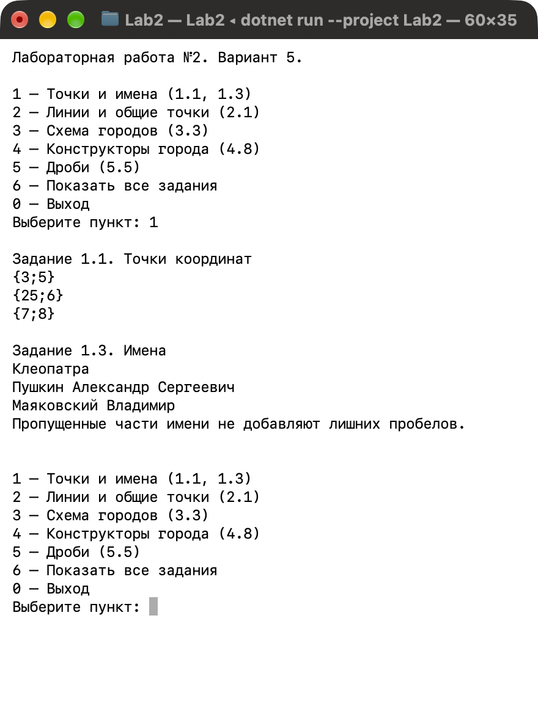
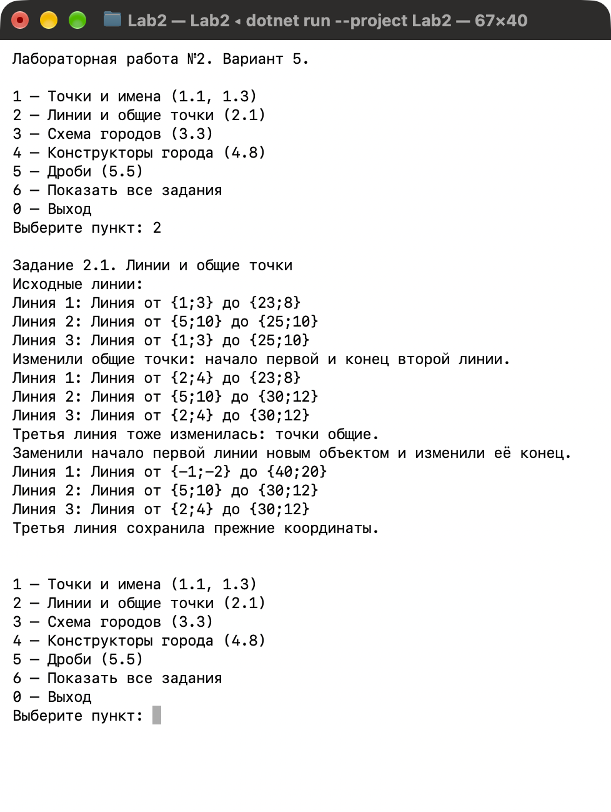
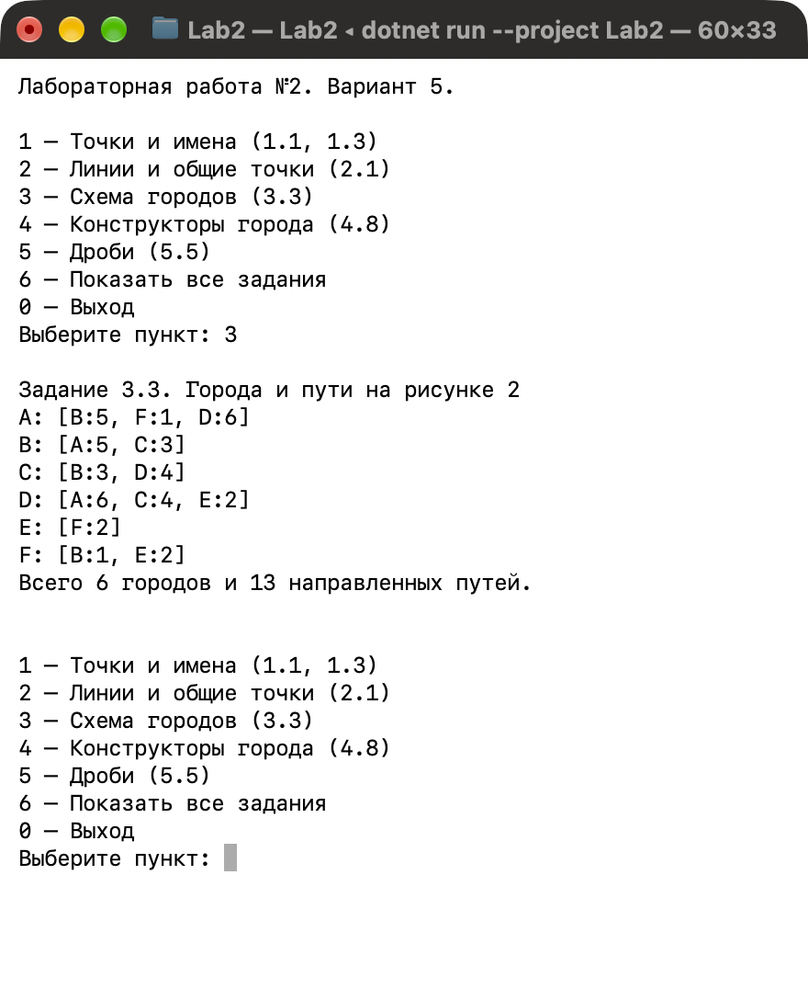
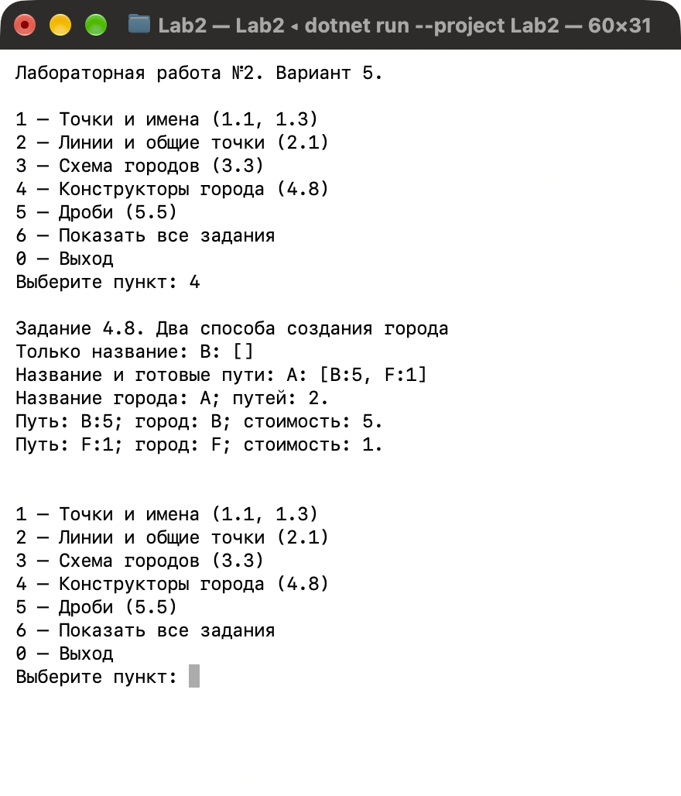
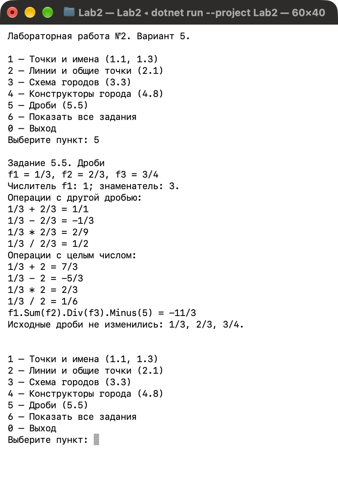

# Лабораторная работа №2 — вариант 5

Выполнил: Владимиров Савелий Олегович, ИТ-1  
Дисциплина: объектно-ориентированное программирование

## Цель работы

Реализовать задания варианта 5 на C#: создать классы, задать конструкторы и свойства, проверить работу со ссылками и перегрузку методов.

Все задания находятся в одном консольном проекте, каждый предметный класс — в отдельном файле. У каждого класса есть свойства, конструктор и метод `ToString()`.

## Запуск

В Rider откройте [Lab2.sln](Lab2.sln) и запустите проект `Lab2`. Требуется .NET 10 SDK.

Из терминала в папке решения:

```powershell
dotnet run --project Lab2/Lab2.csproj
```

Пункты меню `1–5` показывают отдельные задания, `6` — все задания, `0` — выход. При ошибочном вводе программа повторяет вопрос. Исходные данные заданы в коде.

## Задания варианта

| Задание | Подпункт | Смысл | Классы |
| --- | --- | --- | --- |
| 1 | 1.1 и 1.3 | Точки и имена с необязательными частями | `Point`, `PersonName` |
| 2 | 2.1 | Линии с общими точками | `Line`, `Point` |
| 3 | 3.3 | Города и стоимость направленных путей на рисунке 2 | `City`, `Route` |
| 4 | 4.8 | Создание города с путями и без них | `City` |
| 5 | 5.5 | Четыре действия с дробями и целыми числами | `Fraction` |

## Результаты

Скриншоты сделаны при запуске `dotnet run` в терминале.

### 1. Точки и имена

`PersonName.ToString()` пропускает отсутствующие части имени и ставит один пробел между оставшимися.



### 2. Общие точки линий

Третья линия создаётся из начала первой и конца второй линии, то есть из тех же объектов `Point`. `Point` — класс, поэтому переменные хранят ссылки на объекты. `firstLine.Start.X = 2` меняет общую точку. `firstLine.Start = new Point(-1, -2)` заменяет ссылку только у первой линии; третья сохраняет старую точку.



### 3–4. Города и конструкторы

По рисунку 2 получается 6 городов и 13 направленных путей. `A → B` не создаёт обратный путь автоматически. `Route` хранит ссылку на город назначения и стоимость; `City` хранит список `List<Route>`, созданный в конструкторе.

`new City("B")` создаёт `B: []`. `new City("A", routes)` с путями в B за 5 и F за 1 создаёт `A: [B:5, F:1]`. Конструктор с одним параметром вызывает второй с пустым массивом путей.

Связи между городами могут образовывать циклы. Поэтому `Route.ToString()` выводит только `Destination.Name`, а не полный город с его путями: бесконечного обхода графа нет.





### 5. Дроби

При `f1 = 1/3`, `f2 = 2/3`, `f3 = 3/4` каждое действие показано с дробью и с целым числом 2. Цепочка `f1.Sum(f2).Div(f3).Minus(5)` вычисляется как `1 / (3/4) - 5 = 4/3 - 5 = -11/3`. Каждый метод возвращает новый объект, поэтому исходные дроби остаются прежними.

Конструктор сокращает дробь через НОД и переносит знак в числитель. Нулевой знаменатель и деление на ноль запрещены. Промежуточные вычисления выполняются в `long`; если сокращённый результат не помещается в поля `int`, `checked` вызывает исключение переполнения.



## Проверка

| Проверка | Как проверялось | Результат |
| --- | --- | --- |
| Ввод в меню | `abc`, `9`, затем допустимый пункт | Запрос повторяется |
| Нулевой знаменатель | `new Fraction(1, 0)` | `ArgumentOutOfRangeException` |
| Деление на ноль | `new Fraction(1, 3).Div(0)` | `DivideByZeroException` |
| Знак и сокращение | `new Fraction(2, -6)` | `-1/3` |

## Вывод

Выполнил задания варианта 5 и проверил их через меню. Общие точки, направления путей и результаты действий с дробями соответствуют условию.
